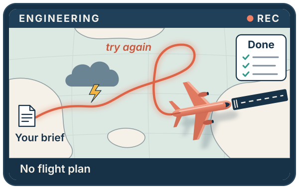
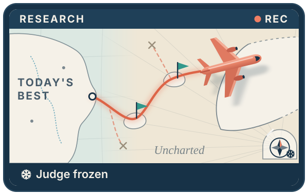
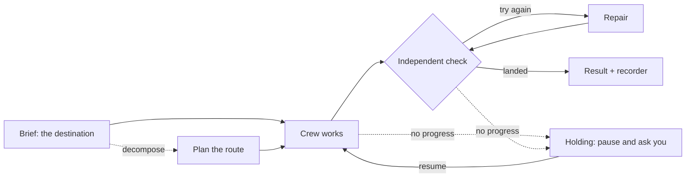
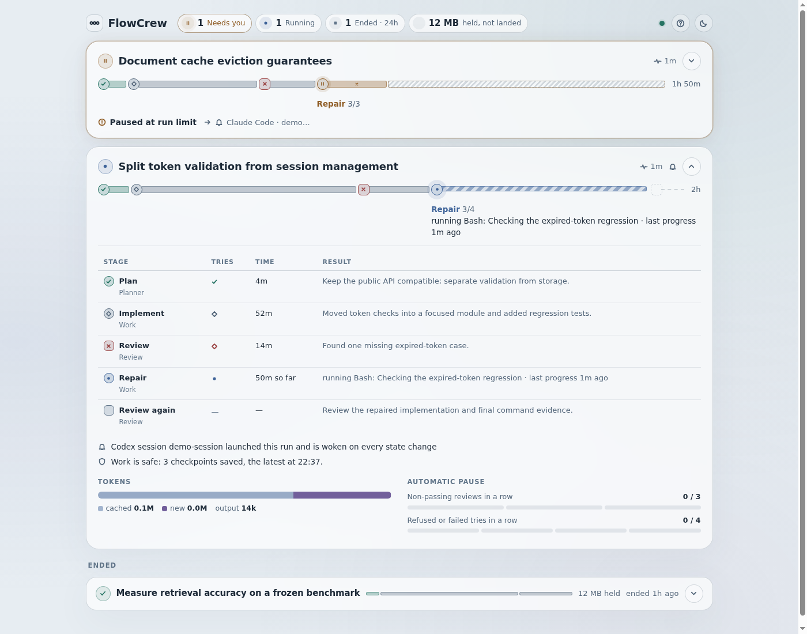

<p align="center"><b>FlowCrew</b></p>

<h1 align="center">Give it a destination.<br>Not a flight plan.</h1>

<p align="center">Run your AI agents like a long-haul flight crew: they plan the route, reroute, and cross-check, for days if needed, with every move on the recorder.</p>

<p align="center">
  
  
</p>

<p align="center"><b>Stay in your flow. Let the crew fly.</b></p>

<p align="center"><a href="#take-off">Take off</a> · <a href="#the-destination-is-a-brief">Write a brief</a> · <a href="#how-the-crew-flies">How it flies</a> · <a href="#why-trust-the-landing">Why trust it</a></p>

<p align="center"><b>FlowCrew runs Claude Code or Codex on long coding and research tasks, for hours or days, while you get on with your own work.</b></p>

<p align="center"><b>Left, engineering:</b> land on the runway, every criterion passed by an independent review and every required check run by the engine.<br><b>Right, research:</b> find new land, a result that beats today's best on a frozen evaluator, or a record that nothing did.</p>

---

Run directly, a long task needs a babysitter: someone keeps the session going, pushes the agent on when it stops, and checks its claim that it is done.
FlowCrew starts the agent from a written goal, has a separate reviewer judge the result against it, runs your checks itself, repairs rejected work, pauses to ask you when progress stalls, and records every step.

<p align="center">
  <a href="LICENSE"></a>
  = 22.22.2" />
  
  
</p>

## Take off

1. **Install.** You need Node.js 22.22.2+, Git, Python 3 and rsync, plus an authenticated Codex CLI or Claude Code for live work:

   ```bash
   git clone https://github.com/cuibuaa/flow-crew.git
   cd flow-crew
   npm ci --ignore-scripts
   npm run build
   npm link
   ./skills/install.sh
   ```

   [Installation details](guide/getting-started.md).
2. In Claude Code or Codex, describe where you want to end up and type `/ship` (Claude Code) or `$ship` (Codex). It writes the brief with you, checks it, and asks you to confirm the exact saved brief before anything starts.
3. Go back to your own work. Check in any time with `/fc-status` (Codex `$fc-status`), which can also open the dashboard. To steer, stop or keep the results, ask the session that launched the run.

> [!WARNING]
> **Everything a run starts uses your OS account's ordinary rights.** FlowCrew keeps work in a separate project copy and records evidence, but it does not confine files, credentials, network or other processes. Read the [full execution boundary](guide/operations.md#platform-boundaries) and approve the exact saved brief digest before you start.

## The destination is a brief

A brief says what "arrived" looks like. It never says how to get there. It settles three things: what done means (criteria in plain sentences), what must not change (tests, evaluators or data marked frozen), and which checks the engine runs itself on the final code (commands such as your test suite). It also names the files the run must produce.

`/ship` turns your conversation into a brief, checks it, and shows you the whole saved brief before anything starts. For example, say "reject header values that contain newlines, and keep every existing test passing". `/ship` drafts a brief with that as its criterion, `src` as the output the run may change, the `tests` folder frozen and `npm test` as a required command. It shows you the saved brief, its digest, its command ids and the execution boundary, and waits for your yes. It then reports the run id. When the run ends, `/fc-status` shows how it ended (`complete`, or blocked, failed or paused with the reason), and landing puts the new `src` in `deliveries/<run-id>/`.

A research brief works the same way: freeze the evaluator, and name the possible results, such as "a candidate beat today's best" and "nothing beat it; every attempt is recorded". Two runnable [research example briefs](examples/README.md#research-briefs) show both outcomes. For the exact format, read the [brief contract](guide/brief-contract.md) and the [minimal example](examples/README.md#check-a-brief).

## How the crew flies



| On a flight deck | In FlowCrew |
| --- | --- |
| No flight plan from the passenger | The brief states the destination. By default one author works toward it and a reviewer checks it; with `decompose: true` a planner draws the stages first. |
| Pilot flying | Your existing agent CLIs, Codex or Claude Code, do the work. |
| Pilot monitoring | A separate review judges the result against your criteria. Nobody grades their own work. |
| Go-around | Rejected work is repaired and returns to the same review. |
| Frozen instruments | Frozen tests, evaluators and data are checked against their original bytes at the end of every attempt. Changes are put back; if the original can't be proven back, the run stops and keeps the evidence. |
| Holding pattern | When two more rejections fail to beat the best attempt so far, or after four failures without a completion, the crew pauses and asks you. Nothing is thrown away. |

## Permissions the agents run with

Agents run with approval prompts turned off: Claude Code with `--permission-mode bypassPermissions`, Codex with `--sandbox danger-full-access`.
FlowCrew does not load your own Claude Code or Codex settings, allow/deny rules or hooks for these calls and offers no setting to restrict them, so the agent never stops to ask for approval.
What guards your work is the project copy, the frozen-input check and the review, not a sandbox.

## Cost and what limits a run

FlowCrew has no billing of its own: every model call goes through your own Codex or Claude Code CLI and its login, so it counts against that subscription or API account.
There is no cap on total spend, tokens or time, and FlowCrew cannot predict what a run will cost.
The hard limit is on unproductive tries: after four failed tries without a completed one, or two more rejected reviews that fail to beat the best attempt, the run pauses and makes no more model calls until you resume it.
A command in the brief can carry its own time limit (`durationMs`), after which it is stopped, and you can stop the run at any time.
Each call's token counts are recorded in the run's status and shown on the dashboard; when Claude Code reports a dollar cost, that is recorded too.

## Stopping a run and getting results back

To stop a run, or resume one the crew paused, ask the session that launched it. Stopping closes every process an author or command started: on Linux with a systemd user session a cgroup guarantees this; elsewhere FlowCrew kills processes carrying FlowCrew's environment marker, and processes that clear their environment can escape. Effects outside the machine, such as remote jobs, are yours to clean up.
The agent works in the run's own project copy, not in your repository, and FlowCrew does not merge, commit or push to your repository.
The copy, its saved checkpoints and the evidence stay until you land the run.
Landing copies the files the brief declared as outputs to `deliveries/<run-id>/` in FlowCrew's store (by default under `~/.local/state/flowcrew/store`), labelled as a reviewed, accepted delivery or not, then deletes the copy. You review those files and bring what you want into your repository; to throw a run's work away, do not copy it.

## Watching a run: the dashboard

Ask `/fc-status` (Codex `$fc-status`) to open the dashboard; it gives you the URL, normally **http://127.0.0.1:8795**.

<picture>
  <source media="(prefers-color-scheme: dark)" srcset="assets/dashboard-dark.png" />
  
</picture>

The page groups attention into **Needs you**, **Running** and **Ended** (the header counts endings in the last 24 hours).
Each run has one time track showing where time went and the current stage.
Expand a run to see tries, review results, saved checkpoints and why it stopped.
It shows each author's live tool activity and flags a tool or command with no observed progress for 10 minutes.
In Claude Code, if the run was started bound to your session, the installed session hook wakes that session when the run ends or needs you; Codex has no such hook, so check with `$fc-status`.

The dashboard is **read-only**; act in the session that launched the run.
[Operations and controls](guide/operations.md#inspect-guide-and-stop).

## Why trust the landing?

- **The engine runs the checks, not the agent.** Required commands run on the final code, supervised by the engine.
- **The instruments are frozen.** The engine compares frozen inputs with their original bytes at the end of every attempt and puts changed ones back. This is detection and restore, not a lock: see [platform boundaries](guide/operations.md#platform-boundaries).
- **Someone else signs off.** An independent review judges every result against your criteria, in its own invocation, without your guidance. Any change a reviewer makes to the project is rejected. Rejected work goes around.
- **The recorder keeps everything.** Command output, verdicts and file history stay in a private Git repository for each run until you land it. Run events stay in SQLite.
- **Trust, then read.** A successful run means its declared checks and review passed; read the actual work and evidence before accepting it. Skills are instructions to the coding agent, whose compliance the engine cannot guarantee.

## Runs on

- Linux and macOS (both run in CI) with Node.js 22.22.2 or later, Git, Python 3 and rsync.
- systemd is optional. Containers are not certified.
- Agents: your existing Codex and/or Claude Code CLIs, with their own logins. Codex is the default backend; ask `/ship` to use Claude instead for a run.

## When not to use FlowCrew

- A small edit you would watch anyway: run your agent directly.
- You can't yet say what "arrived" looks like: settle that first. Nobody can land on a destination that hasn't been named.
- You need the answer in minutes: the crew is built for long trips, and cross-checking takes time.

## Learn more

[Getting started](guide/getting-started.md) · [Example briefs](examples/README.md) ·
[Brief contract](guide/brief-contract.md) · [CLI reference (for scripts and CI)](guide/cli.md) ·
[Configuration](guide/configuration.md) · [Design and guarantees](guide/architecture.md) · [Contributing](CONTRIBUTING.md)

## License

[MIT](LICENSE).

## Author

Single-maintainer project. FlowCrew Captain — LinkedIn: [Profile](https://www.linkedin.com/in/qian-cui/)
