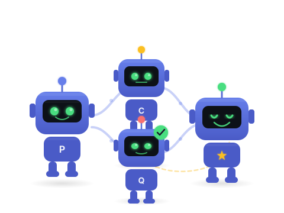
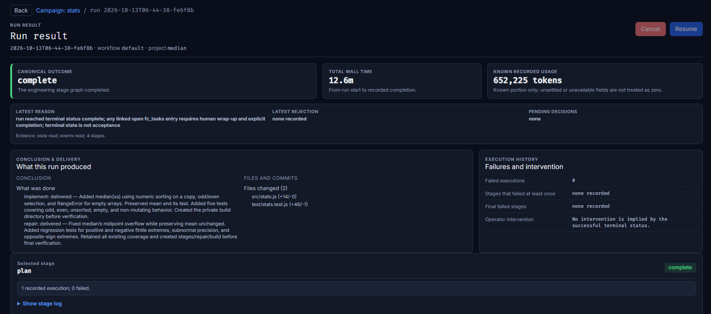
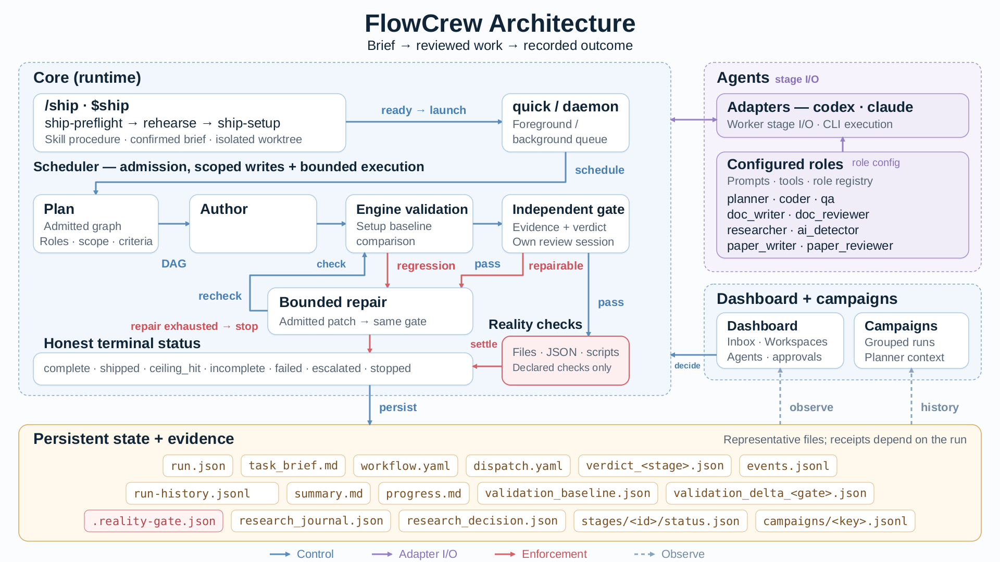

<p align="center">
  
</p>

# FlowCrew

<p align="center"><strong>Give it a brief. Get reviewed work and an honest outcome.</strong></p>
<p align="center"><em>A multi-agent engine for long-running AI work.</em></p>

<p align="center">
  <a href="LICENSE"></a>
  = 22.5" />
  
  
</p>

An illustrative conversation:

```text
> Split token validation from session management. Keep the public API
> compatible, add regression tests, and report the checks and their results.
> /ship
```

Use `/ship` in Claude Code or `$ship` in Codex. FlowCrew turns a written brief into planning, scoped workers,
independent reviews and retained evidence. **You probably don't need FlowCrew** for one bounded task;
[choose your path](#choose-your-path) when the work needs a persistent run with checks and repair loops.

## You bring the problem. It brings the rigor.

- **Checks before opinions.** Engine-owned configured validation settles against the setup baseline before every
  gate review. Recorded regressions go straight to admitted repair; reviewers cannot approve them.
  Unresolved validation stops review.
- **Independent gates, bounded repairs.** Authors have downstream independent gates. Rejected work returns through
  admitted repairs to the same gates within a configured budget. Exhaustion stops work instead of repeating the whole plan.
- **Distinct, honest outcomes.** `complete` is engineering completion; `shipped` is research or declared-terminal delivery;
  `ceiling_hit` ends research without a metric win; `incomplete` means insufficient completion. `failed` and
  `reality_gate_failed` record execution/check failures; `escalated` is unresolved or irreparable;
  `phase_complete` ends a phase; `stopped` records a stop.
- **Interruptible work.** `task cancel` stops registered work; `task resume` continues stopped, failed or incomplete
  runs with completed stages, plan, history and remaining budget. `task retry` requests another launch attempt,
  starting a fresh run after terminal settlement.

See [lifecycle and operations](guide/operations.md#identities-and-lifecycle) and
[task commands](guide/cli.md#services-and-tasks), including paused and queued states.

| Point it at… | Kind | What comes back |
|---|---|---|
| Improve a measured baseline | Research | Journaled measurements and a ship, ceiling, incomplete or failure outcome; confirmation when declared |
| Implement a module to a spec | Engineering | Scoped implementation, independent verdicts and configured validation results |
| Refactor while preserving behavior | Engineering | Reviewed changes checked against the brief's criteria and configured tests |
| Investigate an intermittent defect | Engineering / campaign | Related run history and evidence for the reproducer, diagnosis and fix required by the brief |

<p align="center">
  
</p>

## From brief to verified run



This summarizes the review path; research also has measured rounds and a stopping policy.
An optional race tries one private candidate through gates and bounded repairs before trying a second.
The selected patch still faces the parent run's gates. Declared reality checks govern terminal success,
with advisory exceptions. See [races](guide/agent-protocol.md#planner-selected-races) and
[deterministic checks](guide/brief-contract.md#deterministic-checks).

## Get started

### 1. Clone, install and link the CLI

You need Node.js 22.5+ and Git for worktree setup. From a checkout you own:

```bash
git clone https://github.com/cuibuaa/flow-crew.git
cd flow-crew
npm ci --ignore-scripts
npm ci --ignore-scripts --prefix ui
npm run build
node dist/cli.js --help
npm link
which flowcrew
```

The build produces the engine and dashboard. `npm link` changes the global command link;
check which checkout it selects. [Getting started](guide/getting-started.md) covers local CLI use.

### 2. Install the coding-agent skills

```bash
./skills/install.sh
```

The installer skips absent agent executables. Live runs need an installed, authenticated Codex CLI or Claude Code.
**Recommendation: plan in Claude Code, execute in Codex.** The default `auto` backend selects Codex when both
CLIs are installed, or the only installed CLI. [Adapter configuration](guide/configuration.md#precedence-and-adapters).

### 3. Rehearse without model tokens

```bash
flowcrew rehearse examples/hello-research.brief.md
```

Rehearsal calls no model and exercises scripted research settlement in a disposable project.
It runs the brief's declared shell confirmation; inspect unfamiliar commands first, or use
`--static-only`. A ready verdict checks wiring, not research quality. [Example recipe](examples/README.md#rehearse-a-research-contract).

### 4. Hand off with `/ship`

Describe the goal and evidence, then invoke `/ship` in Claude Code or `$ship` in Codex.
The [ship procedure](skills/ship.md) calls for exact-byte rehearsal and digest confirmation before setup
and launch into an isolated worktree with a measured validation baseline. Skills are instructions to
the coding agent; the engine does not guarantee that it follows them.

### 5. Watch, cancel and resume

```bash
flowcrew start
flowcrew watch
flowcrew status
flowcrew task cancel <numeric-id>
flowcrew task resume <numeric-id>
```

`start` runs the dashboard at `http://localhost:3000/` by default; use another terminal for `watch` and `status`.
Use task controls as needed with the registered task's numeric ID. Dashboard Resume sits beside Cancel;
it preserves completed work and remaining budget. Retry starts fresh after terminal settlement.
Parked approvals use Inbox decisions. [CLI](guide/cli.md#services-and-tasks) · [Operations](guide/operations.md#inspect-guide-and-stop).

## What you can run

These prompts are illustrative; only [`examples/hello-research.brief.md`](examples/hello-research.brief.md)
is a complete example that runs as written, through rehearsal.

### Research — beat a baseline

```text
> Improve docs-search relevance over the measured baseline. Declare a fresh-split
> confirmation and a search budget. An honest ceiling or incomplete outcome is fine.
> /ship
```

The numeric policy computes keep/drop and continue/ship/ceiling from recorded rounds.
A declared confirmation runs on a ship decision; failure rejects that candidate.
[Research contract](guide/brief-contract.md#research-rounds).

### Engineering — satisfy a contract

```text
> Refactor the parser while preserving the public API. Require the configured
> build, full tests and lint, and report evidence for each acceptance criterion.
> /ship
```

Engineering checks the brief's contract through independent gates and configured validation.
[Engineering contract](guide/brief-contract.md#engineering-and-workflow-selection).

### Unknown-bug hunt — build on a campaign

```text
> Investigate the intermittent checkout failure. Require an unfixed reproducer,
> a diagnosis, and recurrence evidence after the fix. Group related attempts.
> /ship
```

A campaign groups run history. Later planners receive a compact ledger of tried research directions
and recorded results, even when verbose campaign context is skipped. Prior measurements inform planning;
they do not guarantee novel proposals.
[Campaign operations](guide/operations.md#campaigns).

## What makes it work

- **Roles with limited authority.** The planner proposes a graph; admission checks roles,
  scope, topology and criterion coverage. Authors produce work; independent gates judge it.
  Their verdicts cannot override engine validation, admitted scope or check thresholds.
- **Every hand-off is a checkable artifact.** Typed stage answers, gate verdicts and declared
  output/input locations make results inspectable. Location checks establish required paths
  and producer bindings; content quality still needs criteria and review.
- **Stopping is a rule.** Research policy owns numeric keep/stop decisions. Repair limits,
  attempt deadlines and a deterministic idle watchdog bound execution.

The [architecture](guide/architecture.md) and [artifact protocol](guide/agent-protocol.md) explain these boundaries.

## When this is the wrong tool

For a short task you can supervise in one session, start with your coding agent. If you cannot state acceptance
evidence or provide a suitable workspace for unattended shell access, refine the brief and environment first.
A successful status is evidence about the admitted contract, not a guarantee that a model's claims are true.
Checks and their inputs need to express the outcome you actually want.

> [!WARNING]
> **Live runs receive unattended shell access.** The adapters select bypass modes for normal
> approval and sandbox prompts. Scope checks and approval requests govern the engine's protocol;
> they are not an operating-system sandbox. Use a dedicated workspace, read the brief and review
> its evidence before accepting the result. To stop an intentionally selected registered task,
> use `flowcrew task cancel <id>` and inspect settlement as explained in [operations](guide/operations.md#inspect-guide-and-stop).

## Choose your path

| You are… | Start here | Next reference |
|---|---|---|
| A new user | [Getting started](guide/getting-started.md) | [Runnable examples](examples/README.md) |
| An operator or brief author | [Brief contract](guide/brief-contract.md) | [Operations](guide/operations.md), [CLI](guide/cli.md), [configuration](guide/configuration.md) |
| A contributor | [Contributing](CONTRIBUTING.md) and [AGENTS.md](AGENTS.md) | [Architecture](guide/architecture.md), [agent protocol](guide/agent-protocol.md) |

## License

[MIT](LICENSE).

## Author

Single-maintainer project. FlowCrew Captain — LinkedIn: [Profile](https://www.linkedin.com/in/qian-cui/)
