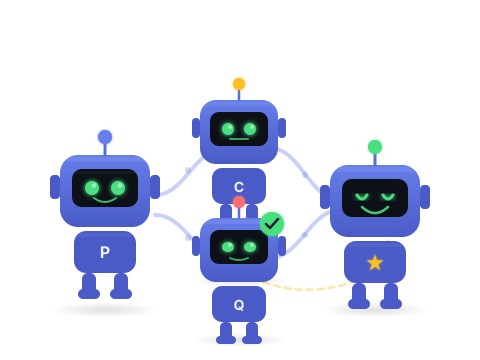
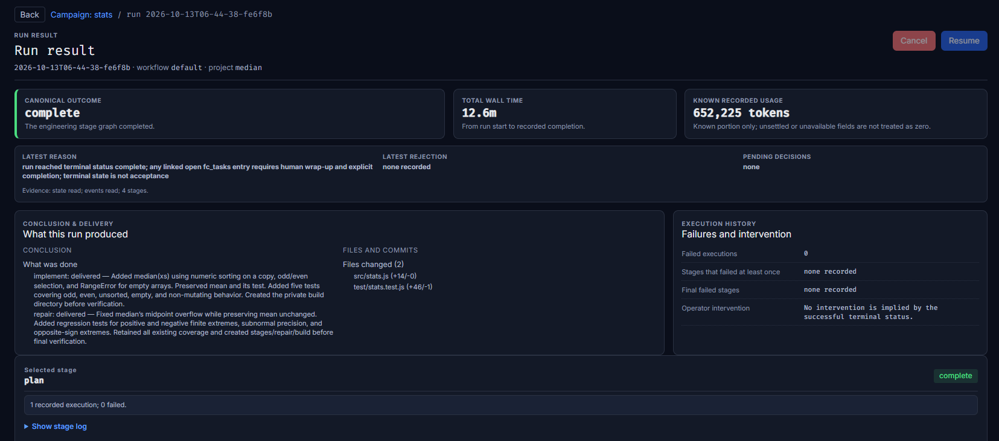

<p align="center">
  
</p>

# FlowCrew

<p align="center"><strong>Give it a brief. Get reviewed work and an honest outcome.</strong></p>
<p align="center"><em>A multi-agent engine for long-running AI work.</em></p>

<p align="center">
  <a href="LICENSE"></a>
  = 22.22.2" />
  
  
</p>

An illustrative conversation:

```text
> Split token validation from session management. Keep the public API
> compatible, add regression tests, and report the checks and their results.
> /ship
```

Use `/ship` in Claude Code or `$ship` in Codex. FlowCrew turns a written brief into planning, workers,
independent reviews and retained evidence. **You probably don't need FlowCrew** for one bounded task;
[choose your path](#choose-your-path) when the work needs a persistent run with checks and repair loops.

## You bring the problem. It brings the rigor.

See [lifecycle and operations](guide/operations.md#identities-and-lifecycle) and
[run controls](guide/cli.md#read-and-steer), including parked work and manual continuation.

| Point it at… | Kind | What comes back |
|---|---|---|
| Improve a measured baseline | Research | Frozen evaluator inputs, declared command evidence, independent review and a project report |
| Implement a module to a spec | Engineering | Implementation, independent verdicts and configured validation results |
| Refactor while preserving behavior | Engineering | Reviewed changes checked against the brief's criteria and configured tests |
| Investigate an intermittent defect | Engineering | Related run history and evidence for the reproducer, diagnosis and fix required by the brief |

<p align="center">
  
</p>

## From brief to verified run

Each authoring stage has one author. Independent read-only gates judge the brief's
criteria alongside declared command evidence and output preservation. See the
[stage protocol](guide/agent-protocol.md) and [brief contract](guide/brief-contract.md).

## Get started

### 1. Clone, install and link the CLI

You need Node.js 22.22.2+ and Git for worktree setup. From a checkout you own:

```bash
git clone https://github.com/cuibuaa/flow-crew.git
cd flow-crew
npm ci --ignore-scripts
npm run build
node dist-rewrite/cli.js --help
npm link
which flowcrew
```

The build produces the rewritten CLI, monitor and standalone session hook. `npm link` changes the global command link;
check which checkout it selects. [Getting started](guide/getting-started.md) covers local CLI use.

### 2. Install the coding-agent skills

```bash
./skills/install.sh
```

The installer skips absent agent executables. Live runs need an installed, authenticated Codex CLI or Claude Code.
Runtime roles select the backend, model and effort; start may override the backend.
[Adapter configuration](guide/configuration.md#precedence-and-adapters).

### 3. Check a brief without model tokens

`flowcrew setup brief.md` checks declaration syntax and real host sandbox readiness.
It executes no declared command and prints no digest. [Example recipe](examples/README.md#check-a-brief).

### 4. Hand off with `/ship`

Describe the goal and evidence, then invoke `/ship` in Claude Code or `$ship` in Codex.
The [ship procedure](skills/ship.md) writes a self-contained brief, runs setup and shows both, then requires new explicit
confirmation before starting unchanged bytes in isolated work. Skills are instructions to
the coding agent; the engine does not guarantee that it follows them.

### 5. Inspect and control runs

Use `flowcrew status <run-id>` with the id returned by start. Text guidance queues
without interrupting; cancel interrupts; resume continues parked work. After restart,
continuation is manual. Read [operations](guide/operations.md#inspect-guide-and-stop)
and the current [session integration boundary](guide/session-push.md).

## What you can run

These prompts are illustrative. [Examples](examples/README.md) shows the current brief grammar
and identifies historical fixtures that require migration.

### Research — beat a baseline

```text
> Improve docs-search relevance over the measured baseline. Declare a fresh-split
> evaluator, stopping policy and allowed results. Require original measurement evidence.
> /ship
```

Declare evaluators as frozen inputs, exact measurement commands and the allowed result
labels. Independent review judges the criteria; the engine preserves command evidence.
[Evidence policy](guide/brief-contract.md#evidence-authoring-policy).

### Engineering — satisfy a contract

```text
> Refactor the parser while preserving the public API. Require the configured
> build, full tests and lint, and report evidence for each acceptance criterion.
> /ship
```

Engineering checks the brief's contract through independent gates and configured validation.
[Engineering contract](guide/brief-contract.md#inputs-outputs-and-validation).

### Unknown-bug hunt — build on evidence

```text
> Investigate the intermittent checkout failure. Require an unfixed reproducer,
> a diagnosis, and recurrence evidence after the fix. Group related attempts.
> /ship
```

Declare relevant prior evidence as inputs. Prior measurements inform investigation;
they do not guarantee novel proposals. [Authoring principles](guide/brief-contract.md#authoring-and-verification-principles).

## What makes it work

- **Roles with limited authority.** The planner proposes a graph; admission checks roles,
  topology and criterion coverage. Authors produce work; independent gates judge it.
  Their verdicts cannot waive required commands, frozen-input protection or output preservation.
- **Every hand-off is a checkable artifact.** Typed stage answers, gate verdicts and declared
  output/input locations make results inspectable. Location checks establish required paths
  and producer bindings; content quality still needs criteria and review.
- **Stopping retains work.** C2 parks after repeated nonprogress or failures. Explicit
  resume continues parked work; command-local duration limits and cancellation remain available.

The [architecture](guide/architecture.md) and [artifact protocol](guide/agent-protocol.md) explain these boundaries.

## When this is the wrong tool

For a short task you can supervise in one session, start with your coding agent. If you cannot state acceptance
evidence or provide a suitable workspace for unattended shell access, refine the brief and environment first.
A successful status is evidence about the admitted contract, not a guarantee that a model's claims are true.
Checks and their inputs need to express the outcome you actually want.

> [!WARNING]
> **Live runs receive unattended shell access.** The adapters select bypass modes for normal
> approval and sandbox prompts. Brief constraints guide stages; the engine checks declared input
> and output contracts inside a host sandbox. Read the [platform limits](guide/operations.md#platform-boundaries),
> brief and evidence before accepting the result. For every run, closure confirmation covers
> the recorded process group; processes that leave it are outside this guarantee. To stop an intentionally selected run,
> use `flowcrew cancel <run-id>` and inspect settlement as explained in [operations](guide/operations.md#inspect-guide-and-stop).

## Choose your path

| You are… | Start here | Next reference |
|---|---|---|
| A new user | [Getting started](guide/getting-started.md) | [Example briefs](examples/README.md) |
| An operator or brief author | [Brief contract](guide/brief-contract.md) | [Operations](guide/operations.md), [CLI](guide/cli.md), [configuration](guide/configuration.md) |
| A contributor | [Contributing](CONTRIBUTING.md) and [AGENTS.md](AGENTS.md) | [Architecture](guide/architecture.md), [agent protocol](guide/agent-protocol.md) |

## License

[MIT](LICENSE).

## Author

Single-maintainer project. FlowCrew Captain — LinkedIn: [Profile](https://www.linkedin.com/in/qian-cui/)

## Runtime command defaults

Run `flowcrew --help` for the installed command syntax. For example, `flowcrew setup brief.md` checks the brief and host,
`flowcrew start brief.md` prepares isolated work and prints a run id, and `flowcrew status <run-id>` inspects it.
Use `flowcrew guide <run-id> "guidance text"`, `flowcrew cancel <run-id>`, `flowcrew resume <run-id>`, and
`flowcrew land <run-id> --reclaim` for explicit controls. `flowcrew doctor` performs a real sandbox test and prints the host's reason and fix.

Storage defaults to `$XDG_STATE_HOME/flowcrew` (or `$HOME/.local/state/flowcrew`), with `state.sqlite` and a `store/` directory.
`FC_HOME` overrides the database directory, `FLOWCREW_STORE_ROOT` overrides the store, and `FLOWCREW_RUNTIME_ROOT` selects the
installed package for new runs. Existing runs retain independent production-runtime copies. Setup never executes declared commands;
their feasibility is established during the run. Reclaim preserves relative outputs in `store/deliveries/<run-id>/`, leaves external
outputs in place, and deletes workspace, runtime pin and raw evidence only after preservation succeeds. SQLite history and status remain.
