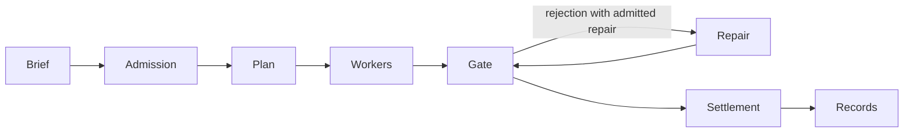

# Architecture

For a contributor: which engine boundary enforces each guarantee and limitation?

## Execution and settlement

This diagram summarizes engineering. Research declares a frozen project instrument with initialize, evaluate and finalize phases. The engine dispatches an author and optional declared project review, preserves snapshots and lossless receipts, restores the incumbent and enforces budgets. The project instrument owns verdicts, diagnostics, early stopping and report content.
The scheduler owns graph execution and settlement; the worker owns one adapter execution.
Planning and judging are model work when live adapters are selected. Admission, declared
checks, deadlines, process identity and publication integrity are code boundaries.

A planner's typed result supplies the graph. Roles and check descriptors are supplied from
registries; unknown roles and invalid whole-plan topology refuse admission.
[Agent protocol](agent-protocol.md) owns dispatch/verdict/artifact schemas and retained continuation.
[Brief contract](brief-contract.md) documents research instrument declarations and deterministic checks.
Ordinary failed work follows admitted bounded repairs, then stops; it does not force an
unbounded outer re-plan. Deliberate next-phase engineering work can plan more work. Research uses its declared author and optional project review for every submission; the frozen instrument owns verdicts.

Sources: [workflow loop](../src/scheduler/sched_loop/workflow-loop.ts),
[worker](../src/worker.ts), [gate loop](../src/scheduler/sched_loop/gate-loop.ts),
[completion](../src/scheduler/sched_settlement/completion.ts).

## Deadlines and idle progress

Each scheduled execution has only its author-declared allowance, shared by setup,
adapter retries, backoff, corrections and operator guidance. There is no engine duration
default or earlier wrap-up cut. At expiry, the worker stops its owned child and waits for
the actual child/group close event. Slow closure alone never voids the attempt.
[The protocol](agent-protocol.md#stage-budgets-and-retained-continuation) describes the
result: typed unfinished work retains admitted files and follows the ordinary continuation
path in the same DAG. It is not a technical failure and does not grow the allowance.
Settlement checks monotonic expiry even when timers were starved. Explicit cancellation
and integrity refusal retain their authority. Claude waits for actual closure after its
native result, and native home helpers wait for their exit/error events.

The always-used deterministic watchdog polls at a default 30 seconds and binds observations
to the active execution index/start. Changed output, artifact or command CPU/I/O evidence
advances idle progress. A provider with no active command needs growing socket receive-byte
counters or output/artifact progress; CPU activity/writes alone are not provider receive progress.
Linux receive sampling uses `ss` and owned socket inodes. Missing/inaccessible counters provide
no evidence. Unchanged counters cannot rule out GPU/container/remote work. Local commands
and finalization remain subject to the silence bound; old verdicts cannot protect a new attempt.
A verified idle abort does not consume an ordinary failure retry.

On POSIX, deadline/abort termination sends SIGTERM to the detached stage process group, then
SIGKILL after a fixed five-second grace if needed. Cleanup time does not extend the deadline;
records retain elapsed time and overrun through child settlement. Windows keeps immediate
direct-child termination because Node does not provide equivalent process-group signal
semantics. There is no model supervisor or supervision launch flag; settings live in
[configuration](configuration.md#engine-defaults).

Sources: [deadline](../src/attempt-deadline.ts), [watchdog](../src/stage-watchdog.ts),
[adapter process boundary](../src/adapters/base.ts),
[technical policy](../src/scheduler/sched_admission/configuration.ts).

## Process supervision and recovery

Background tasks run through a portable Node shim that records running/exit facts atomically.
Where a systemd user session is usable, a unit supplies cgroup cleanup with `KillMode=mixed`;
it is not configured for automatic crash restart. Both paths use the captured launch
environment and a non-login shell, excluding invocation/service-manager keys. This process
shim is separate from the removed model supervisor and the stage idle watchdog.

Linux binds PIDs to procfs start tokens. Without procfs, the fallback uses second-resolution
`ps -o lstart=` start time and recorded command, a weaker identity. An unreadable binding means unbound,
not proven dead. A shim exit record can survive daemon death; a hard-killed shim may never
publish an exit. Unknown fate cannot justify automatic retry, because work may still exist.

New checkpoints record boot, loaded generation and owned command groups. Startup reconciliation
first excludes a live scheduler. Proven prior-boot death or closed owned command groups can
establish a resumable interruption, preserving completed work and budget and repending
interrupted work. Missing checkpoints, unknown fate or an incompatible admitted plan prevent
continuation. Historical runs retain their older recovery limits.

Sources: [shim](../src/supervise-shim.ts), [supervision records](../src/supervision.ts),
[orchestrator](../src/orchestrator.ts), [process identity](../src/process-liveness.ts), [PID binding](../src/run-lock.ts),
[recovery](../src/restart-recovery.ts).

## Write and publication ownership

The scheduling frontier admits one stage at a time into a shared mutable project tree.
The admitted contract and stage kind determine write access. Authors get the whole project worktree,
their own stage workspace and admitted external outputs/caches. Planner scope lists are only work-division
notes. Read-only gates and isolated decisions get no project grant; hash-only settlement detects changes
on hosts without a kernel grant, fails that attempt and leaves the project untouched by restoration.
Frozen member identities bind once at admission and survive retries/restart. Settlement fails changes;
only matching pinned-base Git content can restore a tracked leaf. Untracked and admission-dirty content
is reported unrestored. There is no generic preimage, byte store, watcher or project rollback.
The worker's existing before/after content identities produce actual applied-write receipts for terminal
independent-review checks. Repair diffs project the evidence ledger rather than planner ownership.

Project validation owns dependency preparation. Each configured validation batch
installs from the current project lockfiles with the discovered package manager's
frozen install command before running checks; preparation failures stop the batch.
Setup captures the target baseline. The ready record fixes the declared commands,
not the installed dependency set:
live gates and settlement prepare from the run's current lockfiles through the same
[validation owner](../src/project-validation.ts).

Declared artifact roots remain confined to their stated trees. Directory members
may reference external tools and dependencies; engine carrier aliases remain refused.
Authored build outputs survive retries and resumes.

Engine mutation-capable filesystem access goes through `engine-fs`, enforced by ESLint.
Reserved run carrier identities and acknowledged history are checked independently of
process supervision. Worker-authored outputs do not become engine records merely by
occupying a stage directory or resembling a reserved name. Native shared SQLite carrier
families have their own ownership boundary. Synchronous engine writes advance the guard
through their filesystem owner; a stage write to an engine carrier still voids its attempt.
Integrity refusal is an execution failure, not ordinary
work that can be retried into authority.

These checks do not turn shell-enabled workers into an OS sandbox. Use an isolated host/workspace
when the task needs stronger access isolation. The brief and injected constraints remain part
of the agent's instructions.

Sources: [batch owner](../src/scheduler/sched_scope/stage-group.ts),
[frozen inputs](../src/scheduler/sched_scope/frozen-inputs.ts), [integrity](../src/engine-integrity.ts),
[filesystem](../src/engine-fs.ts), [ownership](../src/engine-owned-carriers.ts),
[lint rules](../eslint.config.js).

## Evidence and builds

`run.json` is the compact projection; append-only histories and events retain earlier facts.
Its history ref owns the format version and carrier path. New runs use `run-history.jsonl`;
history records have no version field, and readers and resumed writers follow the ref's path.
Built-in adapters record compressed immutable invocation inputs before each native transport
call, including retry inputs. Unknown provider defaults/hidden instructions remain unresolved.
Private adapter homes isolate invocations; managed continuation uses identity-bound
structured predecessor records and never grants scope. [State and operations](operations.md#inspect-guide-and-stop)
explain the read surfaces and archived aliases.

Build compilation stages a complete backend/UI generation and publishes with a manifest-last
transaction. It refuses changes to live output roots; archived generations cannot redirect
a running process's later imports. [Contributing](../CONTRIBUTING.md#build-and-validation)
owns validation commands and private output guidance.

Sources: [store](../src/store.ts), [invocation capture](../src/run-state-view.ts),
[adapter homes](../src/adapter-home.ts), [build publication](../src/build-manifest.ts).
