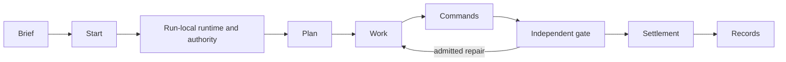

# Architecture

For contributors locating the owner of a guarantee. Operator procedures live in
[operations](operations.md); typed model contracts live in [agent protocol](agent-protocol.md).

## Execution and settlement

The brief declares criteria, resources, exact commands and allowed results. A model
proposes a graph; pure admission checks role/command membership, dependencies and
independent delivery topology. The core selects and settles one mutable frontier.
Authors produce work; independent read-only gates judge all criteria. Declared command
receipts and output preservation constrain delivery beyond a model's verdict.

## Owners

| Boundary | Responsibility |
|---|---|
| `contract/` | Strict brief/runtime/plan/answer grammars and canonical status decoding |
| `core/` | Pure admission, scheduling, review/repair decisions, C2 and settlement |
| `exec/` | Authority interpretation, invocation composition, provider adapters and command execution |
| `records/` | SQLite event/current authority, immutable evidence, checkpoints, runtime pin and preservation |
| `host/` | Real process identity, ownership, sandbox and operation workers |
| `ops/` | CLI composition, setup, control, status, doctor and land |

Code lives under `rewrite-src/`. Monitor readers consume canonical status; the standalone
session hook uses the same decoder without invoking the CLI or SQLite.

## Isolation and process recovery

Start imports isolated source/input work and records exact write grants. Srt enforces
writes for every launched program; frozen inputs and engine records remain protected.
Plan/gate invocations do not receive project writes. Provider approval bypass happens
inside this host boundary. Platform differences, TLS restrictions and escaped process
groups are disclosed in [operations](operations.md#platform-boundaries).

Recorded boot/start/group identities distinguish owners from reused PIDs. Unknown fate
remains unknown and cannot authorize replay or destructive maintenance. Cancel fences
work and closes its recorded group. Restart is observed as an interruption; continuation
requires manual resume. There is no automatic startup pickup.

## Runtime and records

Each run uses a digest-authenticated runtime copy, including production dependencies.
Upgrading the package cannot change an existing run's operation imports. SQLite owns
committed history and current rows; `status.json` is a derived view for hooks and monitor.
Evidence/checkpoints use immutable content identities. Publication of a derived view
never retracts an already committed event.

`land --reclaim` is the sole reclamation path, after preservation and process/accounting
closure. It removes workspace, pin and raw evidence while retaining SQLite history,
status and materialized declared deliveries. See [preservation](operations.md#preserve-and-reclaim).

Sources: [admission](../rewrite-src/core/admission.ts), [loop](../rewrite-src/core/loop.ts),
[settlement](../rewrite-src/core/settlement.ts), [state](../rewrite-src/records/state.ts),
[processes](../rewrite-src/host/process.ts).
