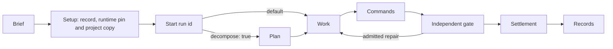

# Architecture

For contributors locating the owner of a guarantee. Operator procedures live in
[operations](operations.md); typed model contracts live in [agent protocol](agent-protocol.md).

## Execution and settlement

The brief declares criteria, resources, exact commands and allowed results. By default the
graph is fixed: an author stage, an independent gate and a repair stage the gate can route
to. A brief with `decompose: true` starts with a planner stage whose proposed graph replaces
it. Pure admission checks role/command membership, dependencies and
independent delivery topology for any graph, including an operator's `guide --plan`. The core selects and settles one mutable frontier at a time; DAG dependencies do not
promise parallel execution. Authors produce work; independent gates judge all criteria
in separate invocations without author guidance. Declared command
receipts and output preservation constrain delivery beyond a model's verdict.

Provider adapters decode their native stdout incrementally. One decoder supplies live
activity, the final answer and usage; provisional tool, message and turn events do not bypass
closure, content or schema authentication. Activity summaries are at most 200 characters
and omit command arguments, message bodies and environment values.

Claude uses stream-json input and output. It sends the initial prompt as a user message,
keeps stdin open for same-turn operator guidance and closes it after the final result.
It starts Claude with `--replay-user-messages`, so Claude echoes each stdin user message
when it takes it into a turn. The live steering hook becomes available when input can be
written; a guide counts as delivered only when its echo arrives, not when it is written.
A root result with a written guide still unechoed is not the end: Claude runs another turn
for that guide, and the invocation stays open until that turn's result, which supplies the
answer. The adapter keeps at most one guide message outstanding and sends guides steered meanwhile as one message after the echo. A guide still unechoed when the invocation ends stays pending. A single reader
consumes new raw-file bytes while the provider runs; it needs no filesystem watcher. Final
decoding or native exit closes stdin. The final root result ends the invocation: Claude
gets 2 s to exit, then the owner is closed. Codex keeps exec with its configuration and rules isolation
flags. It streams activity but exposes no same-turn steering hook; requested steering
is refused and guidance waits for the next author invocation. Independent gates receive
no operator guidance.

## Owners

| Boundary | Responsibility |
|---|---|
| `contract/` | Strict brief/runtime/plan/answer grammars and canonical status decoding |
| `core/` | Pure admission, scheduling, review/repair decisions, C2 and settlement |
| `exec/` | Output facts and settings, invocation composition, provider adapters and command execution |
| `records/` | SQLite event/current authority, immutable evidence, checkpoints, runtime pin and preservation |
| `host/` | Native process identity, invocation containment and closure, detached Node supervisor and operation workers |
| `ops/` | CLI composition, setup, control, status and land |

Code lives under `rewrite-src/`. Monitor readers consume canonical status; the standalone
session hook uses the same decoder without invoking the CLI or SQLite.

## Isolation and process recovery

Setup copies the entire project except `.git` into a per-run workspace, including ignored
files, and imports declared external inputs. Default cwd and private
mutable Git metadata separate ordinary work from the source and checkpoint metadata.
All authors, providers and commands run with host-account rights. Declared inputs and
outputs define content checks and retained evidence. Frozen-input audits detect changes
at observation boundaries; plan/gate project changes are rejected. Same-account programs
can still reach other host paths. The full limits are in
[operations](operations.md#platform-boundaries).

The detached Node supervisor survives launcher exit. Recorded boot/start/group identities
distinguish owners from reused PIDs. On Linux, each author invocation and engine command
uses a cgroup v2 scope when available; closure kills its descendant hierarchy and confirms
that it is empty, including children that create another process group or session. Normal
ending, cancellation and controller recovery use the same typed closure owner. Otherwise,
including on macOS and Linux without a systemd user manager, each invocation carries a
unique environment marker. Closure kills the authenticated group, then repeatedly scans
only current-user processes and kills those retaining the marker until no readable match
remains. The marker owner retires, allowing later work. Receipts name the guarantee:
`cgroup` proves descendant closure; `marker` is best effort and excludes processes that
cleared their marker. Unreadable or macOS SIP-hidden environments are unknown and are
not signalled; their PIDs and the limitation appear in the receipt and status interpretation.
Old owner records without containment still close only their authenticated group. Cancel fences work. Restart is
observed as an interruption; continuation requires manual resume. There is no automatic
startup pickup.

## Runtime and records

Each run uses a digest-authenticated runtime copy, including production dependencies.
Upgrading the package cannot change an existing run's operation imports. SQLite owns
committed history and current rows; `status.json` v4 is a derived view for hooks and monitor.
One canonical decoder also reads historical v2/v3 snapshots. A snapshot records the last
observation; it is not continuous proof that a controller is alive.
Evidence/checkpoints use immutable content identities. Publication of a derived view
never retracts an already committed event.

`land` is the sole reclamation path, after preservation and process/accounting
closure. It preserves the declared outputs first, then removes the project copy, work root,
pin and raw evidence while retaining SQLite history, status and the materialized deliveries.
Status reads the retained file-size measurement (`heldBytes`), or reports `heldSpacePending`
until an ending or control writer measures it; the measurement remains until cleanup completes.
See [preservation](operations.md#preserve-and-reclaim).
